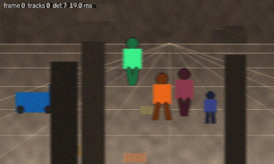

# cv-yolo-detect-track-jetson

Real-time detection and multi-object tracking for an NVIDIA Jetson: a YOLOv8n
detector fine-tuned on a custom object set, ByteTrack and DeepSORT compared on
identical detections, ONNX and TensorRT exports at three precisions, and a ROS2
node publishing detections and persistent track identities.



*Four classes, persistent identities through occlusion, trajectory trails and
the per-frame budget in the corner.  Produced by `make demo`, which also scores
itself against ground truth.*

> **There is no Jetson.**  Every latency number here was measured on a desktop
> with an RTX 4060.  The TensorRT backend, the engine builder and the Jetson
> benchmark script are written and have never been executed.
> [`docs/jetson.md`](docs/jetson.md) says exactly what that costs and what it
> would take to close.

---

## The headline

Accuracy against latency across precisions, on the test split.  Full table and
the machine it came from in [`docs/results.md`](docs/results.md).

| Variant | mAP@0.5:0.95 | Δ vs FP32 | Size | Inference p50 |
| --- | ---: | ---: | ---: | ---: |
| FP32 | 0.8649 | | 12.20 MB | 15.69 ms |
| FP16 | 0.8615 | -0.00344 | 6.14 MB | 18.59 ms |
| INT8, detection head left in float | 0.8549 | -0.01005 | 3.40 MB | 16.88 ms |
| INT8, head quantised too | 0.8193 | -0.04564 | 3.38 MB | 15.28 ms |
| INT8, ONNX Runtime defaults | 0.0000 | -0.86495 | 3.41 MB | 11.81 ms |

Three things that table says, and none of them is the one I expected to write:

**Quantising a YOLOv8 head to INT8 destroys the model silently.**  With ONNX
Runtime's default operator list the graph loads, runs 33 percent faster and
detects nothing: every class score comes out exactly zero whilst the boxes stay
within a couple of pixels of the FP32 ones.  Restricting quantisation to
convolutions recovers almost all of it and excluding the head's seven output
convolutions recovers most of the rest, for 22 KB.  The exclusion list is
derived from the graph rather than hard-coded.

**Precision barely moves the latency on this hardware, and it is not supposed
to.**  `scripts/probe_launch_bound.py` shows the network is kernel-launch
bound at batch 1: eight times the work takes 1.237 times the wall clock and
four times the pixels takes 1.327 times.  FP16 is *slower* than FP32 on both
the CPU and the GPU for the same reason.  That is precisely the gap TensorRT
closes with layer fusion, which is the strongest argument in this repository
for why the Jetson measurement is the one that matters.

**ByteTrack beats DeepSORT here, and a colour histogram beats a trained
embedding.**  0.91194 IDF1 against 0.8946, and DeepSORT with a parameter-free
HSV histogram makes 19 identity switches where the trained embedding makes 32.
[`docs/tracking.md`](docs/tracking.md) takes that apart.

---

## Run it

```bash
sh scripts/setup.sh     # venv, runtime dependencies, published weights
make demo               # detect, track, score against truth, write a video
```

or, with nothing installed but Docker:

```bash
docker compose -f docker/docker-compose.yml up
```

Both fetch the published weights from the GitHub Release, generate a sequence
the model has never seen, run the whole pipeline over it and print real
metrics:

```
synthetic sequence, seed 7, palette depot
  120 frames in 5.48s = 21.9 FPS (onnxruntime/fp32)
  detections 709, unique track ids 8, per-frame p50 20.59 ms
  MOTA 0.97067  IDF1 0.93644  IDsw 1  FP 2  FN 18
  switch causes: {"detector_gap": 0, "occlusion": 1, "crossing": 0, ...}
```

Nothing there is a fixture.  The scene is generated from a seed, the ground
truth is regenerated from the same seed rather than cached, and the metrics are
computed by the same code that produced every number in the docs.

`make help` lists the rest.

---

## What is in here

| | |
| --- | --- |
| **Custom dataset** | A procedural warehouse scene with exact box *and identity* ground truth, plus per-object visibility.  3240 frames, 87 tracked identities, regenerable from a seed in about a minute.  [`data/DATASET_CARD.md`](data/DATASET_CARD.md) |
| **Detector** | YOLOv8n fine-tuned to 0.8649 mAP@0.5:0.95 on a held-out split rendered in a different palette.  [`docs/MODEL_CARD.md`](docs/MODEL_CARD.md) |
| **ByteTrack** | Implemented from the paper, not vendored.  Two-pass IoU association keeping the low-confidence detections. |
| **DeepSORT** | Implemented from the paper.  Matching cascade, Mahalanobis gating, appearance gallery. |
| **Appearance** | A 0.46 MB re-identification network trained on scene crops, exported to ONNX, plus a parameter-free HSV histogram baseline that beats it. |
| **Metrics** | CLEAR-MOT and the ID measures implemented here and cross-checked against `py-motmetrics` on randomised sequences. |
| **ID-switch analysis** | Every switch attributed to a cause using ground-truth visibility, neighbour overlap and speed. |
| **Export** | FP32 and FP16 ONNX, three INT8 variants, and a TensorRT builder for the Jetson. |
| **ROS2** | A real `rclpy` node publishing `vision_msgs` detections and tracks, verified in CI by a real subscriber inside a Humble container. |

---

## Design decisions worth arguing with

**The dataset is generated.**  Hand-labelling identities through occlusions is
the expensive part of a real MOT set, and it is the part this project needs
most: MOTA, IDF1 and the ID-switch attribution are all measured against exact
truth here rather than against another model's output.  The cost is that no
absolute accuracy number transfers to a real camera, which
[`docs/limitations.md`](docs/limitations.md) states first and at length.

**Both trackers were written rather than imported.**  The reference DeepSORT is
GPL-3.0 and would have made this repository GPL; the ByteTrack in Ultralytics is
AGPL and would have put an AGPL import in the runtime.  Writing both also meant
they could share one Kalman filter and one track lifecycle, so the difference
between their results is a difference in association and nothing else.

**The runtime imports neither torch nor ultralytics.**  Checked from the inside
by importing every runtime module in a fresh interpreter and inspecting
`sys.modules`, and from the outside by running `import torch` inside the built
Docker image and failing if it succeeds.  [`docs/licences.md`](docs/licences.md)
explains why that boundary is where it is.

**Tracker parameters were tuned on val, never on test.**  The spread between
the best and worst settings in the sweep is up to 0.03761 IDF1, which is larger
than the gap between the two trackers, so an untuned comparison would have
measured the tuning.

**Every number in the documentation is checked.**  `scripts/check_docs.py`
fails the build if a figure appears in a document that is not in
`results/published/`, and the generated tables are compared byte for byte
against what the generator produces.  CI runs it on every push.

---

## Layout

```
configs/            data, model, train, export, benchmark, one file per tracker
src/edgetrack/
  data/             the scene generator and the on-disk layouts
  detect/           Detector interface, ONNX, PyTorch and TensorRT backends
  track/            Kalman filter, matching, ByteTrack, DeepSORT, appearance
  metrics/          detection AP, CLEAR-MOT, ID measures, switch attribution
  ros2/             payload builders (no ROS needed) and the node
  pipeline.py       detector + encoder + tracker, one code path for everything
scripts/            one entry point per stage, all with --help
tests/              253 tests, no network, no GPU, no weights needed for most
docker/             runtime, training and Jetson images
benchmarks/         results.csv and the empty Jetson table
docs/               results, tracking, jetson, licences, limitations, cards
results/published/  every number quoted anywhere, as JSON
```

This differs from the layout in the original brief in one way: the brief put
`train.py`, `evaluate.py` and friends inside `src/`.  They are in `scripts/`
here so that `src/edgetrack` is an importable library with no entry points in
it, which is what lets `tests/test_runtime_boundary.py` assert that importing
the runtime pulls in nothing from the training toolchain.

---

## Reproducing every number

```bash
sh scripts/setup.sh --train    # adds torch and ultralytics
make data                      # ~1 minute, deterministic from seeds
make train                     # ~13 minutes on an RTX 4060
make reid export quantise      # ~2 minutes
make experiments               # accuracy, tracking, latency
make publish                   # into results/published, regenerate the tables
make check                     # lint, tests, and the documentation check
```

---

## Limitations

The full list is [`docs/limitations.md`](docs/limitations.md), ordered by how
much it should change your reading.  The three that matter most:

1. **No Jetson.**  Every latency figure is from a desktop.  The TensorRT path
   is written and untested.
2. **Generated data.**  Absolute accuracy transfers nowhere.  The *differences*
   between precisions are measured on identical images and do transfer.
3. **ONNX Runtime's CUDA provider does not work on the host.**
   `onnxruntime-gpu` needs a CUDA 13 runtime and the torch build ships CUDA
   12.6, so ONNX rows are CPU-only and the GPU rows come from PyTorch.
   Publishing a GPU row that was secretly a CPU row would have been easier.

---

## Licence

MIT, in [`LICENSE`](LICENSE).  Third-party licences and the AGPL boundary are
in [`docs/licences.md`](docs/licences.md).
